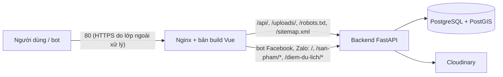

# Cấu hình và triển khai

- [1. Biến môi trường](#1-biến-môi-trường)
- [2. Lưu ảnh trên Cloudinary](#2-lưu-ảnh-trên-cloudinary)
- [3. Đăng nhập Google, Facebook](#3-đăng-nhập-google-facebook)
- [4. Triển khai thật](#4-triển-khai-thật)

Mọi cấu hình nằm trong file `.env` ở thư mục gốc repo (tạo từ `.env.example`, **không commit**). Sau khi sửa `.env`, chạy `docker compose up -d` để tạo lại container có thay đổi.

## 1. Biến môi trường

| Biến | Mặc định | Ý nghĩa |
|---|---|---|
| `POSTGRES_DB`, `POSTGRES_USER`, `POSTGRES_PASSWORD` | `lamdong_ocop`, `postgres`, (bắt buộc) | Database PostgreSQL trong Docker |
| `PGADMIN_DEFAULT_EMAIL`, `PGADMIN_DEFAULT_PASSWORD` | (bắt buộc) | Tài khoản đăng nhập pgAdmin (`http://127.0.0.1:5050`) |
| `DATABASE_URL` | | Chỉ cần khi chạy backend ngoài Docker; Docker Compose tự ghép |
| `JWT_SECRET_KEY` | (bắt buộc) | Khóa ký token, ≥ 32 ký tự. **Phải đổi**: backend từ chối khởi động nếu giữ giá trị mẫu của `.env.example`. Tạo bằng `python -c "import secrets; print(secrets.token_urlsafe(48))"` |
| `JWT_ACCESS_TOKEN_EXPIRE_MINUTES` | `60` | Thời hạn token (1–1440 phút) |
| `CORS_ORIGINS` | `http://localhost:5173` | Địa chỉ frontend được gọi API, phân tách bằng dấu phẩy |
| `VITE_API_BASE_URL` | `http://localhost:8000/api/v1` | Địa chỉ API mà frontend gọi |
| `VITE_MAP_TILE_URL` | | (Tùy chọn, trong `frontend/.env`) nguồn ảnh nền bản đồ ưu tiên; mặc định OpenStreetMap, lỗi thì chuyển sang OpenStreetMap Humanitarian |
| `IMAGE_STORAGE` | `local` | `local` (thư mục `backend/uploads`) hoặc `cloudinary` |
| `CLOUDINARY_CLOUD_NAME`, `CLOUDINARY_API_KEY`, `CLOUDINARY_API_SECRET`, `CLOUDINARY_FOLDER` | | Bắt buộc khi `IMAGE_STORAGE=cloudinary` (mục 2) |
| `PUBLIC_BASE_URL` | | Địa chỉ công khai của backend để ghép URL ảnh lưu cục bộ khi chạy sau proxy/tên miền; trống thì lấy theo request |
| `FRONTEND_BASE_URL` | `http://localhost:5173` | Địa chỉ trang web; Google/Facebook trả người dùng về `FRONTEND_BASE_URL/dang-nhap/mang-xa-hoi/<google\|facebook>` |
| `GOOGLE_CLIENT_ID`, `GOOGLE_CLIENT_SECRET` | | Bật đăng nhập Google (mục 3); trống thì ẩn nút |
| `FACEBOOK_APP_ID`, `FACEBOOK_APP_SECRET`, `FACEBOOK_GRAPH_VERSION` | `v26.0` | Bật đăng nhập Facebook (mục 3); trống thì ẩn nút |
| `NEWS_RSS_URL`, `NEWS_RSS_TIMEOUT_SECONDS`, `NEWS_RSS_MAX_BYTES`, `NEWS_CACHE_TTL_SECONDS` | RSS cổng OCOP tỉnh, 8 giây, 1 MB, 900 giây | Nguồn tin tức |
| `OSRM_BASE_URL`, `OSRM_TIMEOUT_SECONDS` | máy chủ OSRM công khai, 8 giây | Dịch vụ chỉ đường |

## 2. Lưu ảnh trên Cloudinary

1. Tạo tài khoản Cloudinary gói Free (không cần thẻ thanh toán).
2. Ở trang **Dashboard**, chép Cloud name, API key, API secret vào `.env`; đặt `IMAGE_STORAGE=cloudinary`.
3. Chạy `docker compose up -d backend`. Thiếu một trong ba khóa thì backend báo lỗi khi khởi động (xem `docker compose logs backend`).

- Backend gọi API Cloudinary bằng `httpx` (upload, xóa, kiểm tra tồn tại có chữ ký); không cần thư viện của Cloudinary.
- Ảnh đã lưu cục bộ trước đó vẫn dùng được. Giấy chứng nhận sản phẩm luôn lưu cục bộ (riêng tư).
- Gói Free có hạn mức (khoảng 25 credit/tháng). Hết hạn mức hoặc dịch vụ lỗi thì đặt lại `IMAGE_STORAGE=local`.
- Lỡ để lộ API secret: tạo khóa mới trên Cloudinary và cập nhật `.env`.

## 3. Đăng nhập Google, Facebook

Quy tắc tài khoản xem `docs/NGHIEP_VU.md` mục 3. Luồng OAuth 2.0 "authorization code": trình duyệt tạo `state` (và PKCE với Google), Google/Facebook trả về `/dang-nhap/mang-xa-hoi/<nhà cung cấp>`, backend dùng khóa bí mật đổi mã lấy thông tin người dùng rồi cấp JWT. Khóa bí mật chỉ nằm ở backend.

### Google

Giao diện Google có thể đổi tên menu theo thời gian.

1. Vào <https://console.cloud.google.com/>, tạo project (ví dụ `ocop-lam-dong`).
2. Mở **Google Auth Platform**:
   - **Branding**: tên ứng dụng, email hỗ trợ, email liên hệ.
   - **Audience**: chọn **External**. Ở chế độ **Testing**, chỉ tài khoản trong **Test users** đăng nhập được: thêm Gmail của thành viên và tài khoản demo.
   - **Data access**: chỉ cần `openid`, `email`, `profile` (không cần Google xét duyệt).
3. **Clients → Create client → Web application**. **Authorized redirect URIs**: `http://localhost:5173/dang-nhap/mang-xa-hoi/google` (triển khai thật thêm `https://<tên-miền>/dang-nhap/mang-xa-hoi/google`). Không cần "Authorized JavaScript origins".
4. Chép **Client ID**, **Client secret** vào `GOOGLE_CLIENT_ID`, `GOOGLE_CLIENT_SECRET`.

### Facebook

1. Vào <https://developers.facebook.com/> → **My Apps → Create App**, chọn trường hợp sử dụng **Authenticate and request data from users with Facebook Login**, không liên kết doanh nghiệp.
2. Trong use case, mở **Permissions**, bật thêm **email**.
3. **Facebook Login → Settings → Valid OAuth Redirect URIs**: `http://localhost:5173/dang-nhap/mang-xa-hoi/facebook` (triển khai thật thêm bản `https`). Giữ bật **Use Strict Mode** và **Enforce HTTPS** (`localhost` được phép ở chế độ phát triển).
4. **App settings → Basic**: chép **App ID**, **App Secret** vào `FACEBOOK_APP_ID`, `FACEBOOK_APP_SECRET`.
5. Ở chế độ **Development**, chỉ tài khoản có vai trò trong ứng dụng (**App roles → Roles**) đăng nhập được. Chuyển **Live** cần trang chính sách quyền riêng tư công khai.

### Kiểm tra và lỗi thường gặp

Sau khi điền khóa, chạy `docker compose up -d backend` rồi mở <http://localhost:8000/api/v1/auth/social/providers>: kết quả phải có `"google"` và/hoặc `"facebook"`.

| Hiện tượng | Cách xử lý |
|---|---|
| Không thấy nút Google/Facebook | Thiếu ID hoặc Secret, hoặc chưa tạo lại container backend sau khi sửa `.env` |
| Google báo `redirect_uri_mismatch` | Địa chỉ đã khai báo khác `FRONTEND_BASE_URL/dang-nhap/mang-xa-hoi/google` (sai cổng, `localhost` khác `127.0.0.1`, thừa dấu `/`) |
| Google báo "Access blocked … verification process" | Tài khoản chưa có trong **Test users** |
| Facebook báo "URL blocked" | Chưa thêm địa chỉ vào **Valid OAuth Redirect URIs** |
| Facebook báo ứng dụng chưa hoạt động | Tài khoản chưa có vai trò trong ứng dụng |
| "Tài khoản Facebook không cung cấp email" | Người dùng bỏ chia sẻ email, hoặc tài khoản Facebook đăng ký bằng số điện thoại |
| "Phiên đăng nhập không hợp lệ hoặc đã hết hạn" | Để trang Google/Facebook quá 10 phút, mở đường dẫn trả về ở tab khác, hoặc tải lại trang: bấm "Thử lại" |
| "Không kết nối được với Google/Facebook" | Máy chạy backend không ra được Internet |

Lỡ để lộ khóa bí mật: Google tạo secret mới rồi xóa secret cũ trong Client; Facebook bấm **Reset** App Secret; cập nhật `.env`.

## 4. Triển khai thật

Docker Compose gốc (`docker-compose.yml`) dành cho **môi trường phát triển** (backend `--reload`, Vite dev server, cổng database mở trên máy). Bản chạy thật nằm ở `docker-compose.prod.yml`: PostgreSQL + PostGIS (không mở cổng), backend (`backend/Dockerfile.prod`, người dùng thường, 2 tiến trình, `--proxy-headers`) và Nginx (`frontend/Dockerfile.prod`) phục vụ bản build Vue, chuyển `/api/`, `/uploads/` về backend và trả `robots.txt`, `sitemap.xml`.

### Các bước (máy chủ Linux có Docker)

1. Lấy mã nguồn: `git clone <repo> /opt/ocop && cd /opt/ocop`.
2. `cp .env.production.example .env.production`, điền `SITE_URL` (địa chỉ công khai, không có `/` cuối), `POSTGRES_PASSWORD`, `JWT_SECRET_KEY` (chuỗi ngẫu nhiên ≥ 32 ký tự), khóa Cloudinary nếu dùng. File này không commit.
3. `scripts/deploy/trien-khai.sh` (sao lưu, build, khởi động, chờ website phản hồi). Lần đầu, volume database trống nên Docker tự tạo cấu trúc từ `database/schema.sql`; **không nạp seed demo** (`seed_dev.sql`, `seed_product_workflow.sql` có mật khẩu công khai).
4. Tạo tài khoản quản trị: đăng ký trên website rồi nâng quyền bằng lệnh `UPDATE` trong README (mục "Tạo tài khoản quản trị"), dùng `docker compose --env-file .env.production -f docker-compose.prod.yml exec -T postgres …`.
5. Nạp dữ liệu OCOP thật đã kiểm chứng: seed tham chiếu công khai (`seed_public_reference.sql`, `seed_ocop_2025_2026.sql`) hoặc nhập qua giao diện chủ thể và duyệt ở khu quản trị.
6. Database đã có dữ liệu cũ: chạy `database/migrations/014_hoan_thien.sql`, rồi `tools/kiem-tra-database.sql` phải trả rỗng.

### HTTPS

Nginx trong repo chỉ nghe cổng 80. Chọn một cách để có HTTPS (Google/Facebook yêu cầu HTTPS khi chạy thật):

- **Cloudflare** (gói Free): trỏ tên miền về Cloudflare, bật "Full" và proxy; Cloudflare cấp chứng chỉ. Nên giới hạn máy chủ chỉ nhận kết nối từ IP của Cloudflare.
- **Caddy** trước Nginx: `ocop.example.vn { reverse_proxy 127.0.0.1:8080 }` rồi đặt `WEB_PORT=8080` (Caddy tự xin chứng chỉ Let's Encrypt).
- **certbot** trên máy chủ với Nginx của hệ điều hành làm lớp ngoài, chuyển tiếp về `127.0.0.1:WEB_PORT`.

Lớp HTTPS phải gửi header `X-Forwarded-Proto` và `X-Forwarded-For`. Nếu có lớp proxy phía trước, đặt thêm `set_real_ip_from <IP proxy>; real_ip_header X-Forwarded-For;` trong `frontend/nginx/default.conf` để giới hạn đăng nhập tính theo IP người dùng thật. Sau khi có HTTPS: đổi `SITE_URL` thành `https://…`, thêm địa chỉ `https` vào Google/Facebook (mục 3).

### Danh sách kiểm tra

- [ ] `JWT_SECRET_KEY`, `POSTGRES_PASSWORD` mạnh, riêng cho máy chủ; `.env.production` không nằm trong git.
- [ ] Không nạp seed demo. Đổi mật khẩu mọi tài khoản quản trị nếu từng nạp seed demo.
- [ ] HTTPS hoạt động; `SITE_URL` là địa chỉ `https`.
- [ ] Cổng 5432 không mở ra Internet (compose chạy thật không có `ports` cho database).
- [ ] Sao lưu định kỳ: `scripts/deploy/sao-luu.sh` (`pg_dump -Fc` + nén ảnh, giữ 14 bản) chạy bằng cron, chép `backups/` sang nơi khác. Ảnh lưu Cloudinary thì không cần sao lưu ảnh.
- [ ] Giới hạn đăng nhập sai: bộ đếm trong ứng dụng nằm trong bộ nhớ từng tiến trình; Nginx bổ sung `limit_req` 30 lần/phút/IP cho `/api/v1/auth/login`.
- [ ] Tài liệu API (`/docs`) bị Nginx ẩn trên máy chủ thật.

### SEO

- `robots.txt` chặn `/quan-tri`, `/chu-the`, `/tai-khoan`, `/dang-nhap`, `/dang-ky`; `sitemap.xml` liệt kê trang tĩnh, mọi sản phẩm và điểm du lịch công khai (cùng điều kiện hiển thị với API). Cả hai do backend sinh theo `FRONTEND_BASE_URL`.
- Mỗi trang có tiêu đề, mô tả, canonical, Open Graph, Twitter Card; trang cần đăng nhập và trang lỗi gắn `noindex`; trang sản phẩm và điểm du lịch có JSON-LD (`Product`, `TouristAttraction`).
- Bot không chạy JavaScript (Facebook, Zalo, Telegram…) được Nginx chuyển tới HTML tĩnh của backend để thẻ xem trước khi chia sẻ link hiện đúng ảnh, tiêu đề, mô tả. Googlebot chạy JavaScript nên đọc thẳng bản Vue.
- Sau khi có tên miền: gửi `https://<tên-miền>/sitemap.xml` vào Google Search Console; kiểm tra thẻ chia sẻ bằng Sharing Debugger của Facebook.

### CI/CD

- `.github/workflows/ci.yml` (xem README mục Kiểm thử) chạy khi push vào `main` và mọi pull request. Nên bật **branch protection** cho `main`: bắt buộc các job `backend`, `frontend`, `database` đạt trước khi merge.
- `.github/workflows/deploy.yml` triển khai tay (Actions → Deploy → Run workflow) qua SSH bằng `scripts/deploy/trien-khai.sh`. Cần tạo môi trường `production` và các secret `DEPLOY_HOST`, `DEPLOY_USER`, `DEPLOY_SSH_KEY` (khóa riêng chỉ dùng triển khai), tùy chọn `DEPLOY_PATH`. Chỉ dùng khi đã có máy chủ.
