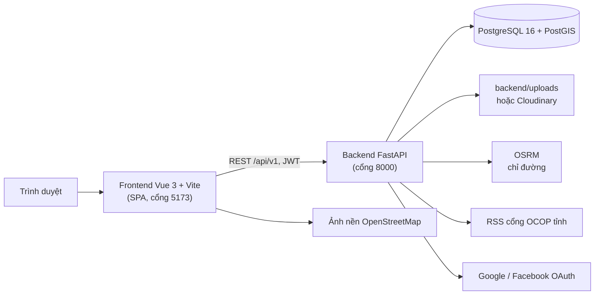
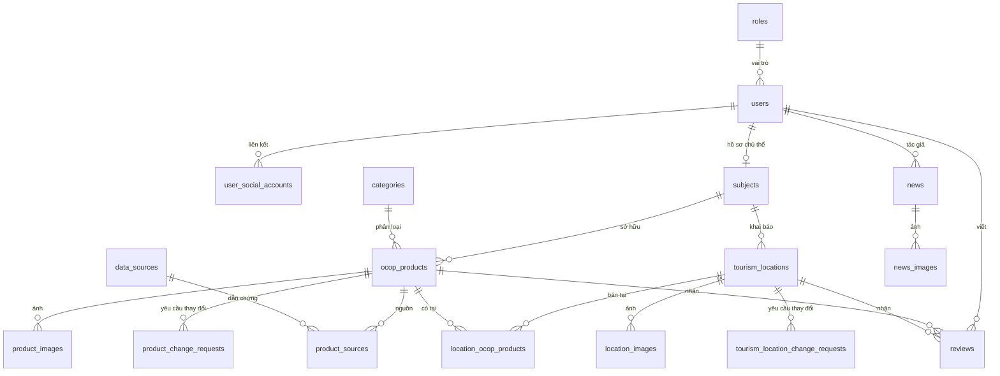

# Kiến trúc và database

- [1. Tổng quan](#1-tổng-quan)
- [2. Cấu trúc mã nguồn](#2-cấu-trúc-mã-nguồn)
- [3. Xác thực và phân quyền](#3-xác-thực-và-phân-quyền)
- [4. Lưu ảnh và file](#4-lưu-ảnh-và-file)
- [5. Database](#5-database)
- [6. Migration](#6-migration)
- [7. Kiểm thử](#7-kiểm-thử)

## 1. Tổng quan



- Frontend là ứng dụng một trang (SPA): định tuyến bằng Vue Router, gọi API bằng Axios, bản đồ bằng Leaflet + markercluster, biểu đồ bằng Chart.js, giao diện Bootstrap 5 + design token riêng (`frontend/src/styles/tokens.css`).
- Backend FastAPI chạy đồng bộ với SQLAlchemy 2 (psycopg 3); mọi lệnh gọi dịch vụ ngoài dùng `httpx` có giới hạn thời gian chờ và kích thước phản hồi.
- PostGIS lưu tọa độ (`GEOMETRY(Point, 4326)`), tính khoảng cách và lọc bán kính trên kiểu `geography` (mét).

## 2. Cấu trúc mã nguồn

```text
backend/app/
  main.py            Tạo ứng dụng, CORS, xử lý lỗi thống nhất, phục vụ ảnh /uploads
  api/router.py      Gom các router dưới /api/v1
  api/routes/        Endpoint theo nhóm: auth, auth_social, products, locations, maps, news, reviews,
                     subject_*, admin_* (mỗi file một nhóm chức năng)
  api/dependencies.py  Lấy người dùng từ JWT, kiểm tra vai trò
  core/              Cấu hình (.env), kết nối database, bảo mật (JWT, băm mật khẩu Argon2),
                     giới hạn đăng nhập sai, tìm kiếm
  models/            Model SQLAlchemy (khớp database/schema.sql)
  schemas/           Schema Pydantic cho request/response
  services/          Nghiệp vụ: quy trình duyệt sản phẩm/điểm, lưu ảnh, tin tức RSS, chỉ đường,
                     đăng nhập mạng xã hội, đánh giá, điều kiện hiển thị công khai
backend/tests/       Test pytest (SQLite trong bộ nhớ; test seed Dehavi dùng PostGIS tạm)

frontend/src/
  views/             Trang: công khai, tài khoản, admin/, subject/
  layouts/           Khung khu quản trị và khu chủ thể
  components/        Thành phần theo chức năng (auth, products, locations, map, reviews, admin, ui…)
  services/          Gọi API (http.ts cấu hình Axios, token, xử lý hết phiên)
  stores/auth.ts     Trạng thái đăng nhập
  router/            Định tuyến, phân quyền phía client, tiêu đề trang
  utils/, composables/, constants/, styles/, types/

database/            schema.sql, migrations/, seed_*.sql, pgadmin/servers.json
tools/               Sinh seed, sinh tài liệu API, kiểm tra database khớp repo
data/                Dữ liệu gốc (OCOP, điểm du lịch) để sinh seed
tests/data/          Test kiểm tra dữ liệu gốc
docs/                Tài liệu (API, nghiệp vụ, dữ liệu, cấu hình, kiến trúc), Postman, văn bản nguồn
```

## 3. Xác thực và phân quyền

1. `POST /auth/login` kiểm tra mật khẩu (Argon2 qua `pwdlib`), trả JWT HS256 chứa `sub` (id người dùng), `role`, `exp`.
2. Frontend lưu token trong `localStorage`, gắn `Authorization: Bearer` cho mọi request.
3. Mỗi request, backend giải mã token, **đọc lại người dùng và vai trò từ database** (đổi vai trò hoặc khóa tài khoản có hiệu lực ngay), từ chối tài khoản bị khóa (`403 ACCOUNT_INACTIVE`).
4. `require_roles(...)` gắn ở cấp router: `/admin` chỉ admin; `/subject` chỉ chủ thể; dữ liệu của chủ thể luôn lọc theo hồ sơ chủ thể lấy từ JWT, không nhận `subject_id` từ client.
5. Frontend: `router/access.ts` chặn trang theo vai trò (chỉ để trải nghiệm, bảo mật thật nằm ở backend). Nhận 401 thì kết thúc phiên và về trang đăng nhập; nhận 403 `ACCOUNT_INACTIVE` thì kết thúc phiên với thông báo tài khoản bị khóa.
6. Đăng nhập Google/Facebook: luồng authorization code; `state` và PKCE do frontend tạo, backend đổi mã bằng khóa bí mật rồi cấp JWT như trên (chi tiết `docs/NGHIEP_VU.md`, `docs/CAU_HINH.md`).

## 4. Lưu ảnh và file

- `IMAGE_STORAGE=local`: ảnh lưu ở `backend/uploads/products|locations/<id chủ thể>/<mã ngẫu nhiên 32 ký tự>.<đuôi>`, phục vụ tĩnh qua `/uploads/...`.
- `IMAGE_STORAGE=cloudinary`: tải lên Cloudinary bằng API có chữ ký.
- Bảng ảnh lưu `image_url` (để hiển thị) và `storage_path` (để kiểm tra quyền sở hữu: đường dẫn phải nằm trong thư mục của chủ thể hiện tại). Ảnh đã gắn với sản phẩm không bị kiểm tra lại nơi lưu khi đổi `IMAGE_STORAGE`.
- Giấy chứng nhận luôn lưu cục bộ trong `uploads/certificates`, **không** phục vụ tĩnh; chỉ tải qua API có kiểm tra quyền.
- Kiểm tra nội dung file (magic bytes), giới hạn dung lượng; không xóa file đang được dùng.

## 5. Database



Ngoài các quan hệ trên, nhiều bảng có cột `reviewed_by` trỏ tới `users` (người duyệt).

| Bảng | Nội dung |
|---|---|
| `roles` | `admin`, `subject`, `user` |
| `users` | Tài khoản; `hashed_password` trống với tài khoản tạo bằng Google/Facebook |
| `user_social_accounts` | Liên kết Google/Facebook; unique (nhà cung cấp, mã người dùng) và (người dùng, nhà cung cấp) |
| `subjects` | Hồ sơ chủ thể và kết quả duyệt (`pending`, `approved`, `rejected`) |
| `categories` | Nhóm sản phẩm; `is_visible`, `sort_order` |
| `ocop_products` | Sản phẩm: thông tin, hạng sao, chứng nhận, trạng thái (`draft`…`archived`), `version`, `is_demo`, `rating_avg`, `views` |
| `product_images`, `location_images` | Ảnh, ảnh chính (tối đa một), nguồn/tác giả/giấy phép |
| `product_change_requests`, `tourism_location_change_requests` | Yêu cầu cập nhật/ngừng hiển thị; `proposed_data` JSONB, `base_version`; tối đa một yêu cầu đang mở mỗi đối tượng |
| `data_sources`, `product_sources` | Văn bản/trang nguồn và vai trò dẫn chứng (công nhận, định danh, địa chỉ, bổ sung) với mức xác minh |
| `tourism_locations` | Điểm du lịch: tọa độ PostGIS, loại hình, dịch vụ, giờ mở cửa, nguồn vị trí, trạng thái duyệt |
| `location_ocop_products` | Sản phẩm bán/giới thiệu tại điểm (nhiều–nhiều) |
| `reviews` | Đánh giá 1–5 sao cho đúng một trong sản phẩm/điểm; trạng thái duyệt, lý do từ chối |
| `news`, `news_images` | Tin do admin đăng (chưa dùng; tin hiện lấy từ RSS) |

Quy ước chung: khóa chính `BIGSERIAL`; thời gian `TIMESTAMPTZ`; trigger `set_updated_at` cập nhật `updated_at` (bỏ qua khi chỉ tăng lượt xem); ràng buộc CHECK cho mọi trạng thái; partial unique index cho "một ảnh chính", "một đánh giá mỗi người", "một yêu cầu đang mở".

## 6. Migration

- **Database mới:** tạo từ `database/schema.sql` (Docker tự chạy khi volume trống). Không cần migration.
- **Database đã có dữ liệu:** chạy `database/migrations/014_hoan_thien.sql`. File này gộp toàn bộ thay đổi từ trước tới nay, chạy trong một transaction, chạy lặp lại an toàn và đưa database ở bất kỳ phiên bản cũ nào lên cấu trúc hiện tại. Các migration riêng lẻ 001–013 lưu ở `database/migrations/archive/` để tham khảo.
- **Kiểm tra khớp repo:** chạy `tools/kiem-tra-database.sql` (pgAdmin hoặc psql). Kết quả rỗng là khớp; `thieu_so_voi_repo` là chưa chạy migration; `thua_ngoai_repo` là thay đổi làm ngoài repo. Công cụ so cả kiểu cột, NOT NULL, giá trị mặc định, nội dung CHECK, định nghĩa index và hàm trigger.
- **Thêm thay đổi database mới:** viết migration mới `015_*.sql` (chạy lặp lại an toàn), cập nhật cùng lúc `schema.sql` và model, rồi sinh lại file kiểm tra: tạo database trống từ `schema.sql` và chạy `python tools/sinh_kiem_tra_database.py <postgresql-url>`.

## 7. Kiểm thử

| Phần | Lệnh | Số test |
|---|---|---|
| Backend | `cd backend && python -m pytest -q` | 272 đạt, 9 bỏ qua (test seed Dehavi chỉ chạy với PostGIS tạm) |
| Frontend | `cd frontend && npm test` | 272 (59 file) |
| Kiểm tra kiểu | `cd frontend && npm run type-check` | |
| Dữ liệu gốc | `python -m pytest -q tests/data` (thư mục gốc) | 10 |

- Backend test chạy trên SQLite trong bộ nhớ (đăng ký hàm khoảng cách thay PostGIS), gọi API thật qua `TestClient`; dịch vụ ngoài (Google, Facebook, Cloudinary, OSRM, RSS) được giả lập bằng `httpx.MockTransport`.
- Frontend test dùng Vitest + Vue Test Utils (jsdom), giả lập service API.
- Kiểm thử luồng đầy đủ trên trình duyệt (khách, người dùng, chủ thể, quản trị viên) và kiểm tra trợ năng bằng axe (WCAG 2.2 AA), tràn ngang ở 375/1280 px được chạy thủ công bằng Playwright trước khi phát hành.
